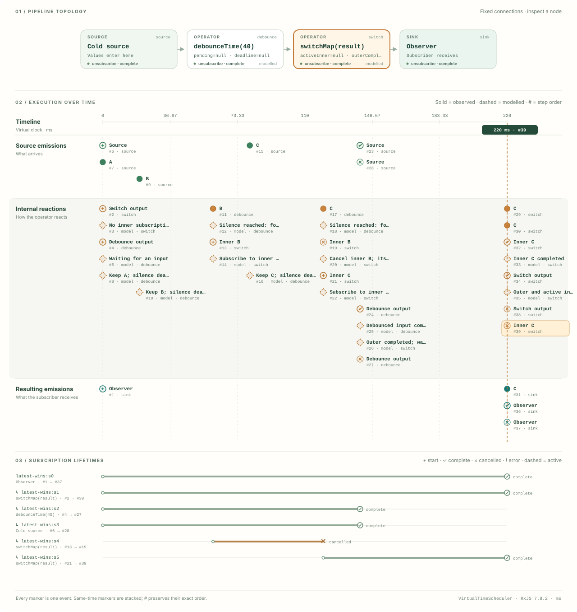

# RxJS execution viewer

**See what an RxJS execution did, when it happened, and why.**

An SVG execution viewer for **RxJS 7.8.2**, built with TypeScript and Vite. It records a real execution, preserves the order of its events, and lets you inspect it without running the pipeline again.

> GPT-6 Astra is the main contributor to this project.

Created in collaboration with [Hans Schenker](https://github.com/hansschenker).

## Run it

Use **Node.js 24 LTS** (24.15 or newer). Node.js 22.22.2 or newer in the 22.x series is also supported. The `.nvmrc` file selects Node.js 24.

```sh
git clone https://github.com/hansschenker/rxjs-execution-viewer.git
cd rxjs-execution-viewer
npm ci
npm run dev
```

Open the local URL printed by Vite. To verify the project and create a production build:

```sh
npm run check
npm run preview
```

The production files are in `dist/`. Relative asset paths allow deployment under a repository subdirectory. This repository does not automatically publish a website.

## What the first version does

- Runs finite examples using real RxJS operators and an explicit `VirtualTimeScheduler`.
- Shows a stable SVG pipeline and **four synchronized lanes: Timeline, Source, Internal reactions, Result**.
- Records subscription identity, values, completion, errors, and cleanup separately.
- Preserves every captured event in a total order, including multiple events at the same virtual time.
- Shows observed boundary events separately from modelled operator state.
- Explains operators with a local **Mealy model: S, S₀, Z, A, T, G**.
- Supports previous/next, start/end, seek, playback, speed selection, and keyboard navigation.
- Imports and exports validated JSON traces.
- Exports a static SVG snapshot and a portable SVG player with its own controls.

The event ledger is the exact inspection surface for dense, simultaneous events. Select an SVG node to inspect its model, or an event to move the replay cursor.

### Included executions

| Example | What to inspect |
| --- | --- |
| Debounce + switchMap | A newer **debounced** value cancels the previous inner subscription. Outer completion waits for the active inner. |
| Synchronous filter / map / take | Values propagate within the same time instant. `take` completes downstream and cancels upstream early. |
| Shared subscriptions | Two downstream subscriptions can share one upstream execution; reference-count teardown is explicit. |

For the first example, source values arrive at 0, 20, and 80 ms. `debounceTime(40)` forwards B at 60 ms and C at 120 ms. Each inner result takes 100 ms. B is cancelled at **120 ms**, and only C reaches the result at **220 ms**. The source completes at 140 ms; the result completes after C finishes. These expectations are checked against the actual RxJS execution in the test suite.



The repository includes the [JSON trace](docs/examples/latest-wins.trace.json), [SVG snapshot](docs/examples/latest-wins.svg), and [portable SVG player](docs/examples/latest-wins-player.svg). Download the player and open it directly in a browser to use its controls. Regenerate the committed examples with `npm run examples`.

## The central distinction

**Pipeline description supplies structure. Execution trace supplies what happened. Operator model explains the reaction. SVG makes them visible together.**

| Layer | Meaning | Evidence |
| --- | --- | --- |
| Pipeline | Declared sources, operators, sinks, and connections | User-supplied metadata |
| Execution | A particular set of subscriptions and notifications | `observed` events at instrumented boundaries |
| Explanation | State transitions that help explain an operator | Explicitly `modelled` state events |
| Replay | A cursor over an immutable recording | Pure projection; no RxJS resubscription |

The viewer does not claim to discover arbitrary JavaScript pipelines automatically, inspect private RxJS closure variables, or enumerate an operator's complete state space. It visualizes recorded executions and the models supplied with them.

### Time and termination

Trace time and playback time are separate. A step is an **event**, not a sampled video frame. `time` records the scheduler clock; `seq` breaks ties in actual observation order. The playback speed changes inspection pace only.

`complete` and `error` are notifications. `unsubscribe` is cleanup and carries a reason: `complete`, `error`, or `cancelled`. Unsubscription does not manufacture a completion event. Each observed boundary gets its own subscription identity; inner and shared executions can be distinguished from the pipeline's declaration nodes.

### State models

Each operator may supply:

| Symbol | Meaning | Viewer label |
| --- | --- | --- |
| S | State space | State |
| S₀ | Initial state | Initial state |
| Z | Input alphabet / events | Input |
| A | Output alphabet / actions | Output |
| T | State transition function | Input controller |
| G | Output / action function | Action policy |

Models in the bundled examples explain behavior; their state records are not instrumentation of RxJS internals. For example, a debounce deadline is a semantic deadline, not a claim that the implementation allocates a new timer for every source value.

## SVG portability

Use **SVG snapshot** for a particular step in documentation. Use **SVG player** to share a finite recording with its own first/previous/play/next/last controls.

Open a player SVG directly in a browser document to use its controls. An `` element, GitHub image preview, or restrictive content-security policy may disable its script; the final execution frame remains available as a static preview. The player needs no network connection or external JavaScript dependencies.

Portable export deliberately has a smaller limit than JSON import because it stores generated frames. The browser app renders one selected scene; it does not store all rendered frames. See [trace format and limits](docs/trace-format.md).

## Project structure

```text
src/core/types.ts          Versioned trace and pipeline contracts
src/core/recorder.ts       Observation and safe payload previews
src/core/replay.ts         Pure cursor projection and lifetimes
src/core/serialization.ts  JSON validation and interchange
src/core/export.ts         Static and portable SVG exports
src/scenarios/            Real RxJS example executions
src/ui/svg.ts              Pure SVG scene renderer
src/ui/styles.css          Responsive application styles
src/main.ts                Browser controls and file operations
tests/                    Execution, interchange, export, and UI checks
```

Read [the architecture](docs/architecture.md), [trace format](docs/trace-format.md), and [contribution guide](CONTRIBUTING.md) before adding a new operator model.

## Scope and next steps

Version 0.1 is a working execution viewer and recording foundation. The next useful extensions are broader operator models (`mergeMap`, `concatMap`, `exhaustMap`, buffering and error recovery), richer causal relationships, incremental live capture, and navigation for very large traces. Arbitrary-pipeline discovery and private-internal instrumentation are separate projects.

The recorder is opt-in: attach observation at the boundaries you want to inspect. Capturing previews consumes time and memory, so it is a debugging aid, not an assertion of zero overhead. Finite capture limits are explicit; a truncated trace is labelled as partial.

## Inspiration and attribution

Stevan Andjelkovic's [Visualising data structures over time using SVG](https://stevana.github.io/visualising_datastructures_over_time_using_svg.html) and [svg-viewer-in-svg](https://github.com/stevana/svg-viewer-in-svg) inspired the portable, inspectable SVG approach. This project implements its own recorder, renderer, and player; it does not include the original Bash packer.

Operator behavior is grounded in [RxJS 7.8.2](https://github.com/ReactiveX/rxjs/tree/7.8.2), including its [debounceTime](https://github.com/ReactiveX/rxjs/blob/7.8.2/src/internal/operators/debounceTime.ts), [switchMap](https://github.com/ReactiveX/rxjs/blob/7.8.2/src/internal/operators/switchMap.ts), [take](https://github.com/ReactiveX/rxjs/blob/7.8.2/src/internal/operators/take.ts), and [share](https://github.com/ReactiveX/rxjs/blob/7.8.2/src/internal/operators/share.ts) implementations.

The initial commit includes the attribution trailer:

```text
Co-authored-by: GPT-6 Astra <noreply@openai.com>
```

MIT licensed. See [LICENSE](LICENSE).
