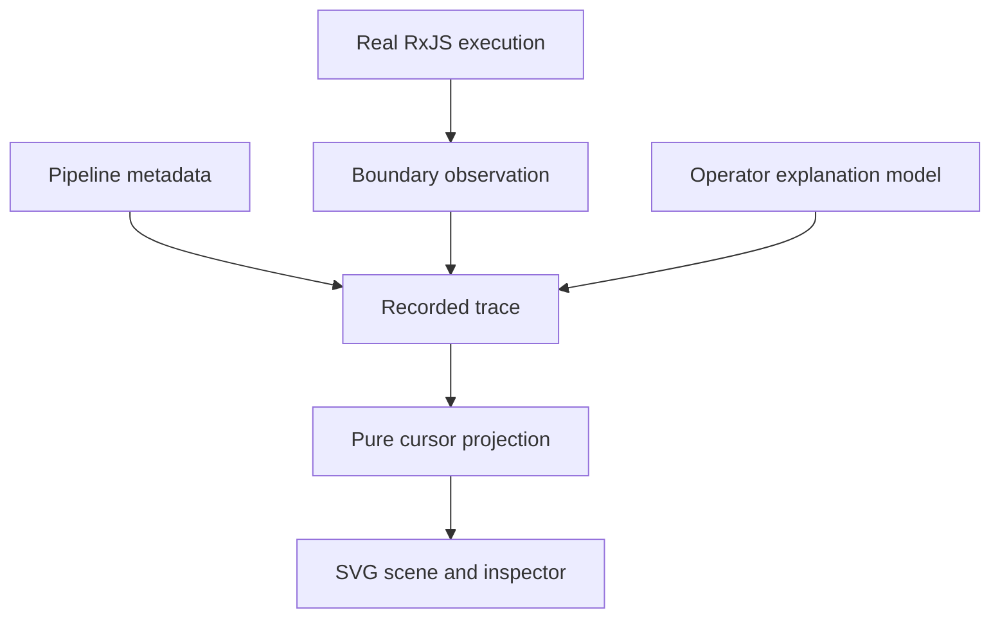

# Architecture

## Start with the question

An execution viewer answers **what happened in this execution, in what order, and under which policy?** A pipeline diagram alone cannot answer that question. The same declaration can have multiple subscriptions, and a sharing operator can let several downstream subscriptions use one upstream execution.

The first version therefore separates four pieces:

The trace owns facts about one finite execution. The renderer receives that trace and a cursor. It cannot subscribe to an observable or execute an operator.

## Recording boundaries

`createRecorder` returns an RxJS observation operator and explicit recording functions. An observation wrapper subscribes to its source once, passes notifications through, and connects its upstream subscriber to downstream teardown before executing the source. That ordering matters for synchronous operators: after `take` reaches its limit, an observed synchronous source must stop producing work just as it does without the recorder.

Each observation wrapper receives a new subscription ID for every subscription. The pipeline node ID identifies a declaration location; it is not a runtime execution ID. Optional parent IDs express ownership known to the recorder. The built-in sharing example explicitly treats the shared upstream connection as a separate lifetime root.

The recorder preserves:

- `subscribe`, before that boundary's source executes;
- `next`, `complete`, and `error`, when received at the boundary;
- `unsubscribe`, when that boundary's subscriber is torn down;
- `state`, an explicitly modelled explanation tied to a subscription.

Teardown has a reason. After a terminal notification its reason is `complete` or `error`; without one it is `cancelled`. An observed boundary is not a global hook for every resource an application may allocate. Uninstrumented operations remain outside the recording.

### Payload previews

Payloads are converted to bounded JSON previews at capture time. Cycles, unsupported values, excessive depth, and oversized strings receive descriptive previews. Ordinary property getters are not evaluated. The trace does not retain the application's mutable payload object.

Previewing is diagnostic work and has overhead. Exotic proxy objects can also execute their own traps during reflection; applications should record small, deliberate values at appropriate boundaries. Trace values are previews, not a lossless domain serialization protocol.

## Observation and explanation

Observed events describe what the recorder received. Modelled events explain it with an explicit state representation. The two have separate badges and SVG styles.

For a new operator, describe its Mealy machine first:

- **S:** the state needed to explain the behavior;
- **S₀:** its initial state;
- **Z:** relevant input events;
- **A:** outputs or actions;
- **T:** the input controller that updates state;
- **G:** the action policy that decides what to emit, schedule, subscribe, or cancel.

This is a local teaching model. It is not necessarily finite, does not enumerate all reachable states, and does not expose the operator implementation's private variables. A model may omit allocation details that do not change the policy being explained. For example, `debounceTime` can reschedule an existing task; a moved semantic deadline is not evidence of a newly allocated timer.

## Event order and clocks

Every event has a nonnegative scheduler time and a consecutive `seq`. Replay advances by `seq`. This preserves synchronous propagation and reentrancy even when all events share one timestamp.

The built-in examples execute with `VirtualTimeScheduler`. No browser timer decides the source's behavior. Browser playback uses its own timer to move the cursor through an already captured trace; speed means inspection events per second, not a new RxJS schedule.

An optional `cause` references an earlier event. Synchronous recorder contexts supply some of these links automatically. It is a partial causal annotation, not a complete scheduler dependency graph. Asynchronous work may need explicit causal links in future instrumentation.

## Replay and rendering

`replayTrace(trace, cursor)` projects the prefix ending at the cursor. Cursor `-1` means before the first event. The projection includes the selected event, latest event and model state per node, and subscription lifetimes known at that point.

`renderTraceSvg` uses fixed geometry for a given complete trace. Moving the cursor changes highlights, visible events, model summaries, and lifetime endpoints. It does not rerun layout from the visible prefix. The four visual lanes remain **Timeline, Source, Internal reactions, Result**.

Dense same-time events are individually addressable in the event ledger even if their glyphs cluster on the time axis. The inspector holds detailed payloads and the full model description; SVG labels remain short. A structured scene cannot replace the event ledger for very dense traces.

## Interchange and export

JSON is the editable interchange format. Validation checks shape, bounds, ordering, IDs, causal references, subscription ownership, and JSON-safe payloads before the application renders anything. Version 1 rejects unknown fields rather than silently assigning them meaning.

Snapshots contain a selected SVG scene. Portable players contain bounded, safely serialized scenes and a small offline player. Each portable frame has scoped IDs. The player uses DOM parsing for generated markup, keeps its cursor in JavaScript state, and handles only relevant keyboard shortcuts.

Portable frame export makes a deliberate file-size tradeoff for convenience. It is capped below the JSON trace limit. The interactive application renders one current scene; it does not pre-render an entire trace. Long-running capture, trace indexing, and scalable incremental SVG updates are later work.

## Verification

Tests target observable behavior: exact emitted values and times, cancellation, terminal notifications, synchronous early teardown, sharing, sequence preservation, replay purity, malicious or malformed input, exported XML, and player controls. Browser interface tests exercise selection and replay controls against the real scenarios.

The build has no server component, account integration, remote trace ingestion, or automatic production deployment. The repository's CI runs the same verification command as local development: `npm run check`.
